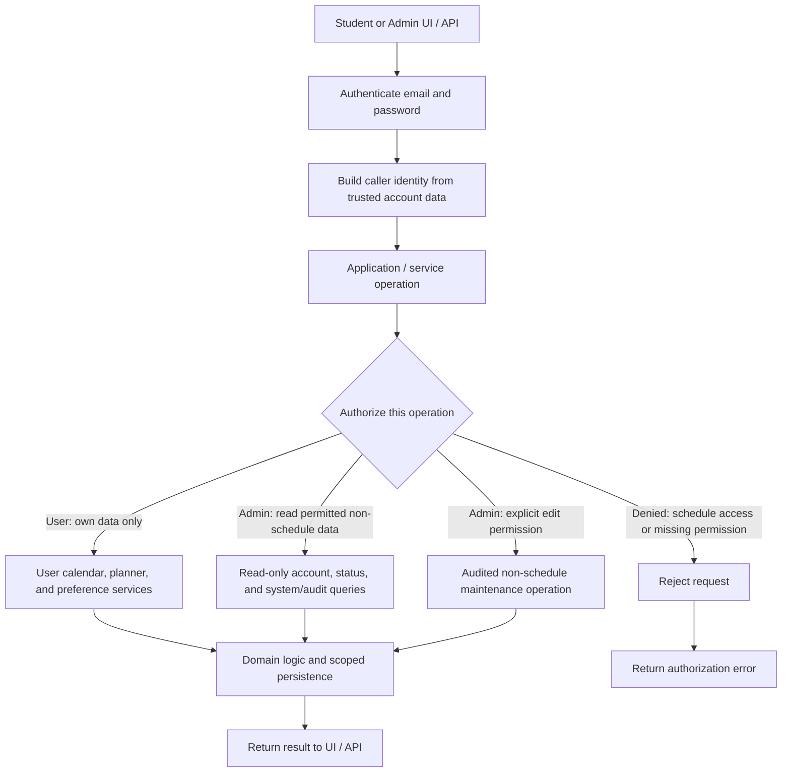

||||| Project Overview |||||

Start Date: August 18, 2026
End(?) Date: December 1, 2026 [Hope to pick up this again in the Spring]

Topic: Decreasing Education Productivity Strain Using AI-Assisted Planner Program

Application Name: HigherScheduling

Interest in Project: Many freshmen struggle to keep up with the demands college brings, time management being the biggest problem. Some don’t know where to start when tackling priorities. Some are unaware of how to arrange their tasks in a way that doesn’t tire them out quickly. Some students go through college slowly learning how to plan, and some never figure it out. Ironically, planning your time turns into the biggest time waster. With the development of AI assisted applications, there is a chance for all these problems to be mitigated.

Target audience: College students who are planning school around their life

||||| Account setup (logic prototype) |||||

Install the password-hashing dependency with `python -m pip install -r requirements.txt`.

The `UserAccountStore` signup flow is:

1. `request_email_verification(email)` creates a passwordless pending account and sends a one-time email token through the configured sender callback.
2. `verify_email(token)` verifies the address and returns a short-lived password-setup token.
3. `set_password(setup_token, password)` stores an Argon2id hash. The plaintext password is never persisted.
4. `create_user(name, email, preferences)` constructs the application User, and `user.login(password, account_store)` authenticates it.

Verification tokens expire, pending registrations are removed after seven days, and verification resends are rate-limited. The application must supply a real email sender and use HTTPS and suitable session/IP-rate-limit controls in production. The SQLite account store persists credentials only; calendars and planners are still in memory.

||||| Application/service-layer authorization (planned) |||||

The UI/API should call application services rather than access domain objects or database tables directly. Authentication establishes the caller's identity; the service loads the role and permissions from trusted server-side data and authorizes each operation.

Admins cannot edit a user's planner, events, or preferences, and cannot view those records through database reports. Admins may read account/status and system/audit information. They are read-only by default; changing database records requires a separate explicit permission and must be limited to non-schedule data and audited. An Admin ID identifies an account but is not a credential. The admin registry, permission grants, service layer, and audit log are planned and are not implemented by the current domain classes. FastAPI could host the API/service layer, but the authorization rules must still be implemented and checked for every operation.

||||| Parts of the project ||||| Under construction

Calendar
- Displays events added and doesn't display events removed
- Can hold recurring events
- Allows events to be color-coded based on the type
- Each day(block) displays events chronologically
- Is referenced by the AI-assistant
- Is read and edited by the User
- Events marked 'complete' in the planner should be marked in the calendar as well
- Events deleted from the calendar should be deleted/ignored by the planner/AI making the planner

Planner
- Is documented weekly (ex. Week 37 of 52; Week 37)
- Shows the schedule of each day of the week
- Can be edited by the user
- Can be edited by the AI-assitant with the user's permission
- Events from the calendar should be shown in here along with the proposed plan
- Should implement sleep schedule, off days, prefered study times, and other user preferences
- If a task relates to an event/due date, they should have the same status (ex. marking the "do homework" task 'complete' should  also mark the real assigment 'complete')

AI-assistant
- 

User Interface
- Can switch between the calendar and planner
- Can navigate through the weeks/months with a click
- Can view the AI-assistant chat on the side of the planner or calendar

Admin Interface [need to research further]
- Should not be able to view a user's schedule
